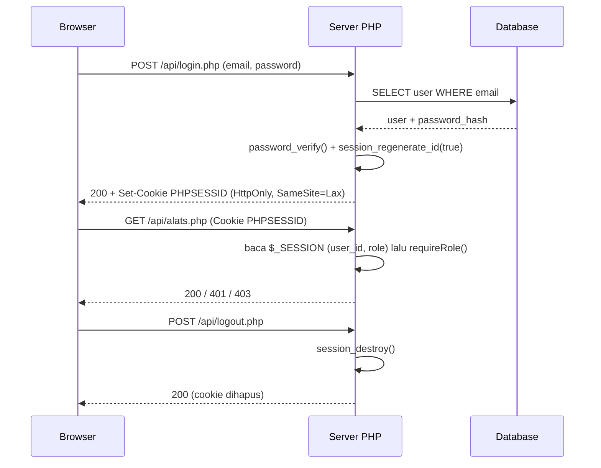
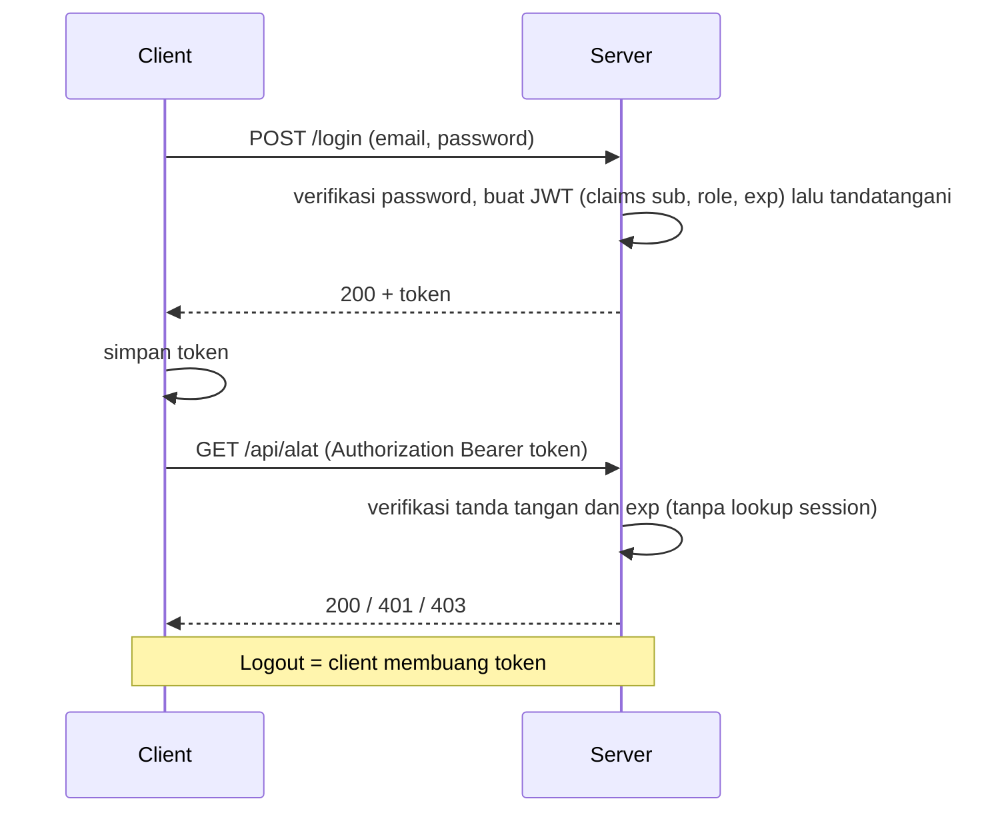

Pemrograman Web - OBE

Proyek awal untuk persiapan praktikum Pemrograman Web berbasis Outcome-Based Education (OBE).

Teknologi yang Digunakan
- PHP 8.4
- Web Server: Apache (Laragon 5)
- HTML5

Cara Menjalankan Proyek via Laragon 5
1. Jalankan Laragon (`Start All`).
2. Pastikan versi PHP diatur ke `8.4`.
3. Simpan proyek di `D:\laragon\www\pemweb-obe`.
4. Akses melalui URL `http://localhost/pemweb-obe/`.

URL Lokal
- `http://localhost/pemweb-obe/`

#ini perubahan yang saya lakuin untuk praktikum

| No | Nama Asset / URL | Method | Status | Content-Type | Size | Fungsi Request |
| :---: | :--- | :---: | :---: | :--- | :---: | :--- |
| 1 | `reset.css?ver=3.4.9` | GET | 200 | text/css | 5,496 B | Menetralkan styling bawaan browser agar tampilan elemen web konsisten. |
| 2 | `theme.css?ver=3.4.9` | GET | 200 | text/css | 5,097 B | Memuat aturan tema dasar, warna, dan font bawaan situs. |
| 3 | `header-footer.css?ver=3.4.9` | GET | 200 | text/css | 7,182 B | Memuat tata letak dan gaya khusus untuk area header dan footer. |
| 4 | `elementor-icons.min.css?ver=5.29.0` | GET | 200 | text/css | 19,778 B | Menyediakan pustaka ikon visual untuk komponen UI Elementor. |
| 5 | `custom-frontend.min.css?ver=1769322192` | GET | 200 | text/css | 173,853 B | Memuat gaya kustom utama untuk keseluruhan tampilan frontend web. |

# Proyek PemWeb - WebLab (Inventaris Laboratorium)

Deskripsi singkat: Portal inventaris laboratorium Teknik Komputer untuk mencatat data alat dan status kondisi laboratorium.

## Cara Menjalankan
1. Jalankan Laragon 5 atau gunakan ekstensi Live Server di VS Code.
2. Buka file `index.html` pada browser.

## Catatan Fitur Selesai
-  Struktur HTML5 semantik (`header`, `nav`, `main`, 3 `section`, `article`, `form`, `footer`)
-  Hirarki heading terstruktur (`h1`, `h2`, `h3`)
-  Penggunaan `alt` text pada gambar (informatif, dekoratif, dan link)
-  Form kontak sederhana dengan `label` terikat `input`
-  Aksesibilitas navigasi keyboard (Tab navigation)

## AI Usage Log
- AI Tool: Gemini
- Penggunaan: Membantu penyusunan struktur HTML5 semantik, penataan alt text gambar, pembuatan form terikat label, serta panduan alur Git workflow.

### Alur login berbasis Session (yang dipakai)

### Alur hipotetis berbasis JWT

| Aspek | Session | JWT |
|---|---|---|
| State | Disimpan di **server** (`$_SESSION`) | Dibawa **di dalam token** (stateless) |
| Penyimpanan di client | Cookie `PHPSESSID` (HttpOnly, tidak terbaca JS) | Memory/storage; perlu dirancang aman |
| Logout | Mudah: `session_destroy()`, sesi langsung mati | Token tetap valid sampai `exp` kecuali ada denylist/revocation |
| Cocok untuk | Web tradisional same-origin (proyek ini) | API stateless, mobile, multi-client |

## Endpoint Autentikasi & Sesi (Modul 12)

| Method | Path | Tujuan | Body | Sukses | Gagal |
|---|---|---|---|---|---|
| POST | /api/register.php | Daftar akun (role viewer) | nama, email, password | 201 | 405, 409, 422, 500 |
| POST | /api/login.php | Login, buat session | email, password | 200 | 400, 401, 405, 500 |
| POST | /api/logout.php | Akhiri session | – | 200 | 405, 500 |
| GET | /api/me.php | Profil user login | – | 200 | 401, 500 |

## Role / Authorization Matrix

| Endpoint | Anonymous | Viewer | Petugas | Admin |
|---|:-:|:-:|:-:|:-:|
| POST /api/register.php | ✓ | ✓ | ✓ | ✓ |
| POST /api/login.php | ✓ | ✓ | ✓ | ✓ |
| POST /api/logout.php | ✓ | ✓ | ✓ | ✓ |
| GET /api/me.php | 401 | ✓ | ✓ | ✓ |
| GET /api/alats.php | 401 | ✓ | ✓ | ✓ |
| POST /api/alats.php | 401 | 403 | ✓ | ✓ |
| PUT/PATCH /api/alats.php?id= | 401 | 403 | ✓ | ✓ |
| DELETE /api/alats.php?id= | 401 | 403 | 403 | ✓ |

**Justifikasi:** aplikasi inventaris lab punya tiga peran dengan tanggung jawab berbeda. Viewer (mahasiswa) hanya melihat ketersediaan alat. Petugas (asisten lab) mencatat dan memperbarui data alat. Admin (dosen/laboran) memegang hak tertinggi termasuk menghapus data, karena penghapusan tidak dapat dibatalkan. Registrasi publik selalu menghasilkan role `viewer`; role petugas/admin hanya diberikan lewat seed/database. Semua pengecekan dilakukan di server (`requireLogin()` dan `requireRole()`), UI hanya menyembunyikan tombol untuk kenyamanan.

## Bukti Skenario Akses (Modul 12)

| # | Skenario | Role | Request | Harapan | Hasil aktual | Screenshot |
|---|---|---|---|---|---|---|
| 1 | Anonymous baca data | – | GET alats.php | 401 | 401 Unauthorized (`UNAUTHENTICATED`: Silakan login terlebih dahulu) | `ss-01-anon-baca.png` |
| 2 | Login salah | – | POST login.php | 401 | 401 Unauthorized (`INVALID_CREDENTIALS`: Email atau password salah) | `ss-02-login-salah.png` |
| 3 | Viewer baca | viewer | GET alats.php | 200 | 200 OK (Data daftar alat tampil beserta total halaman) | `ss-03-viewer-baca.png` |
| 4 | Viewer tambah | viewer | POST alats.php | 403 | 403 Forbidden (`FORBIDDEN`: Akses ditolak, peran tidak memiliki izin) | `ss-04-viewer-tambah.png` |
| 5 | Petugas tambah | petugas | POST alats.php | 201 | 201 Created (Data alat baru berhasil ditambahkan) | `ss-05-petugas-tambah.png` |
| 6 | Petugas hapus | petugas | DELETE alats.php | 403 | 403 Forbidden (`FORBIDDEN`: Akses ditolak, peran tidak memiliki izin) | `ss-06-petugas-hapus.png` |
| 7 | Admin hapus | admin | DELETE alats.php | 204 | 204 No Content (Data alat berhasil dihapus oleh admin) | `ss-07-admin-hapus.png` |
| 8 | Akses setelah logout | – | GET alats.php | 401 | 401 Unauthorized (`UNAUTHENTICATED`: Sesi berakhir setelah logout) | `ss-08-akses-setelah-logout.png` |
| 9 | Register valid | – | POST register.php | 201 | 201 Created (Akun dibuat dengan `role: viewer`, tanpa `password_hash`) | `ss-09-register-valid.png` |
| 10 | Register email ganda | – | POST register.php | 409 | 409 Conflict (`CONFLICT`: Email sudah terdaftar) | `ss-10-register-duplikat.png` |

### Cara Menjalankan Proyek:
1. Clone repository ini ke komputer lokalmu.
2. Salin file `.env.example` dan ubah namanya menjadi `.env`, lalu sesuaikan konfigurasi database (`DB_USER` dan `DB_PASS`) sesuai akun lokalmu.
3. Jalankan perintah `composer install` di terminal untuk mengunduh pustaka *vendor*.
4. Jalankan server lokal (Laragon) dan akses proyek melalui browser atau Postman.

## Latihan Modul 13 (Security Review & Remediation)

### Latihan 1: Tiga Titik Input dan Tiga Titik Output

#### **Tabel Titik Input**
| Titik Input | Lokasi | Kontrol Keamanan |
| :--- | :--- | :--- |
| Form tambah/ubah alat (nama, kategori, jumlah, kondisi) | `crud.js` $\rightarrow$ `alats.php` (POST/PUT) | Validasi server (422), *prepared statement* |
| Query string (`q`, `kategori`, `page`, `limit`, `id`) | `GET alats.php` | Validasi integer, *placeholder*, pembatasan *limit* |
| Form login/register (email, password, nama) | `auth.js` $\rightarrow$ `login.php` / `register.php` | Validasi input, *prepared statement*, `password_hash` |

#### **Tabel Titik Output**
| Titik Output | Lokasi | Kontrol Keamanan |
| :--- | :--- | :--- |
| Tabel data alat | `crud.js` (renderTable) | Render aman menggunakan `textContent` |
| Pesan status/error dan nama user | `crud.js`, `auth.js` | Render aman menggunakan `textContent` |
| Kartu data API publik | `app.js` (renderUsers) | Render aman menggunakan `textContent` (data eksternal tidak tepercaya) |

---

### Latihan 2: Pengujian Peran Viewer & Request Manual (DELETE)
- Verifikasi pembatasan hak akses di mana user dengan peran *viewer* dilarang melakukan modifikasi data.
- Percobaan *request* manual `DELETE` (baik melalui Postman maupun *Console* browser dengan atau tanpa token) akan ditolak oleh server dengan status **`403 Forbidden`**.

---

### Latihan 3: Secret Management & Strategi Keamanan
- Kredensial sensitif seperti `DB_USER` dan `DB_PASS` pada file `.env` disembunyikan menggunakan `.gitignore`.
- Repositori publik hanya mengunggah file templat `.env.example`.
- Aplikasi menggunakan akun basis data khusus berhak akses minimum (`weblab_app`) bukan `root`, serta mengganti kredensial lama yang sempat terekspos.