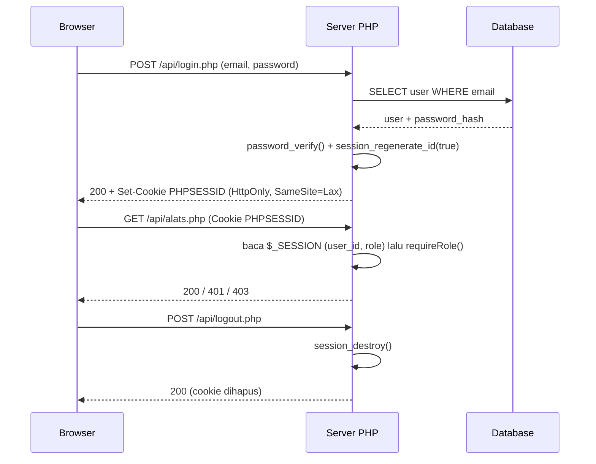
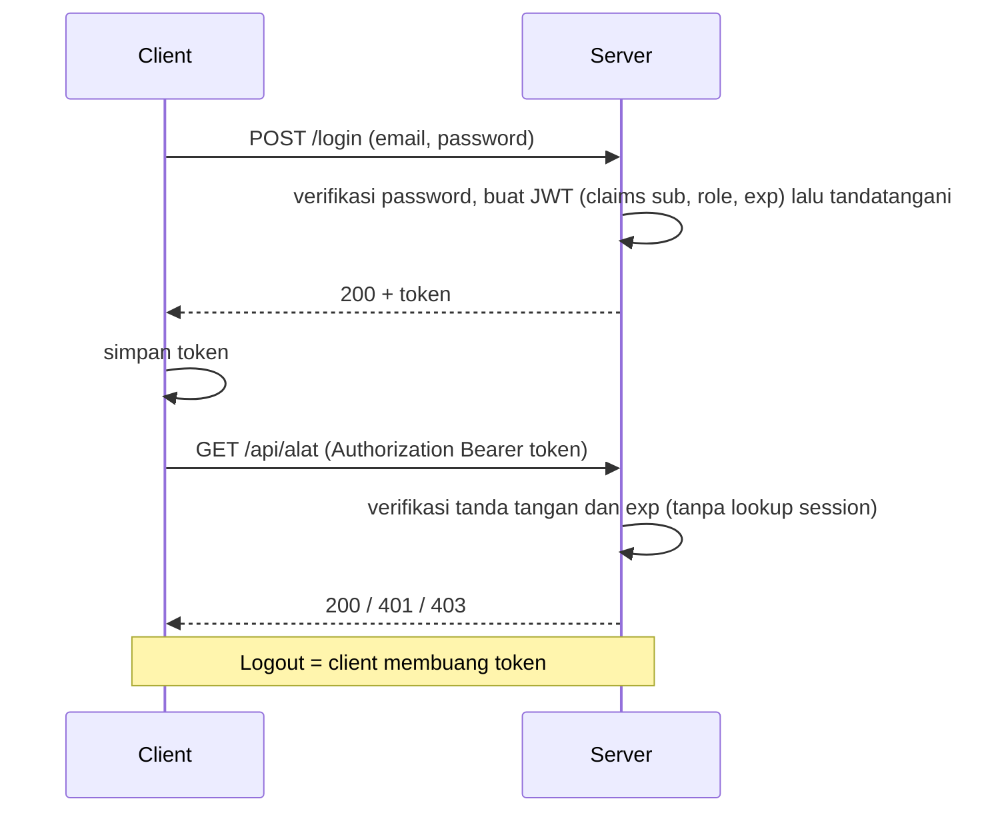

Pemrograman Web - OBE

Proyek awal untuk persiapan praktikum Pemrograman Web berbasis Outcome-Based Education (OBE).

Teknologi yang Digunakan
- PHP 8.4
- Web Server: Apache (Laragon 5)
- HTML5

Cara Menjalankan Proyek via Laragon 5
1. Jalankan Laragon (`Start All`).
2. Pastikan versi PHP diatur ke `8.4`.
3. Simpan proyek di `D:\laragon\www\pemweb-obe`.
4. Akses melalui URL `http://localhost/pemweb-obe/`.

URL Lokal
- `http://localhost/pemweb-obe/`

#ini perubahan yang saya lakuin untuk praktikum

| No | Nama Asset / URL | Method | Status | Content-Type | Size | Fungsi Request |
| :---: | :--- | :---: | :---: | :--- | :---: | :--- |
| 1 | `reset.css?ver=3.4.9` | GET | 200 | text/css | 5,496 B | Menetralkan styling bawaan browser agar tampilan elemen web konsisten. |
| 2 | `theme.css?ver=3.4.9` | GET | 200 | text/css | 5,097 B | Memuat aturan tema dasar, warna, dan font bawaan situs. |
| 3 | `header-footer.css?ver=3.4.9` | GET | 200 | text/css | 7,182 B | Memuat tata letak dan gaya khusus untuk area header dan footer. |
| 4 | `elementor-icons.min.css?ver=5.29.0` | GET | 200 | text/css | 19,778 B | Menyediakan pustaka ikon visual untuk komponen UI Elementor. |
| 5 | `custom-frontend.min.css?ver=1769322192` | GET | 200 | text/css | 173,853 B | Memuat gaya kustom utama untuk keseluruhan tampilan frontend web. |

# Proyek PemWeb - WebLab (Inventaris Laboratorium)

Deskripsi singkat: Portal inventaris laboratorium Teknik Komputer untuk mencatat data alat dan status kondisi laboratorium.

## Cara Menjalankan
1. Jalankan Laragon 5 atau gunakan ekstensi Live Server di VS Code.
2. Buka file `index.html` pada browser.

## Catatan Fitur Selesai
-  Struktur HTML5 semantik (`header`, `nav`, `main`, 3 `section`, `article`, `form`, `footer`)
-  Hirarki heading terstruktur (`h1`, `h2`, `h3`)
-  Penggunaan `alt` text pada gambar (informatif, dekoratif, dan link)
-  Form kontak sederhana dengan `label` terikat `input`
-  Aksesibilitas navigasi keyboard (Tab navigation)

## AI Usage Log
- AI Tool: Gemini
- Penggunaan: Membantu penyusunan struktur HTML5 semantik, penataan alt text gambar, pembuatan form terikat label, serta panduan alur Git workflow.

### Alur login berbasis Session (yang dipakai)

### Alur hipotetis berbasis JWT

| Aspek | Session | JWT |
|---|---|---|
| State | Disimpan di **server** (`$_SESSION`) | Dibawa **di dalam token** (stateless) |
| Penyimpanan di client | Cookie `PHPSESSID` (HttpOnly, tidak terbaca JS) | Memory/storage; perlu dirancang aman |
| Logout | Mudah: `session_destroy()`, sesi langsung mati | Token tetap valid sampai `exp` kecuali ada denylist/revocation |
| Cocok untuk | Web tradisional same-origin (proyek ini) | API stateless, mobile, multi-client |